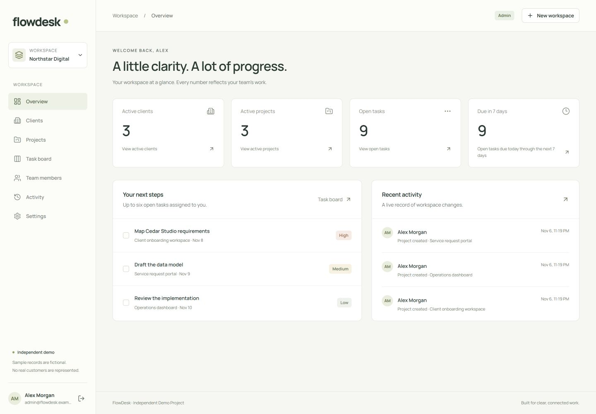
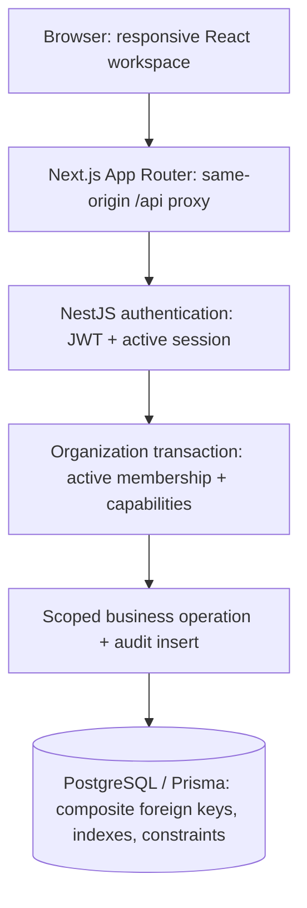

# FlowDesk

**Independent Demo Project**

**All organizations, people and records are fictional.**

A connected operations workspace for small teams: clients → projects → assigned tasks → progress → completion. Built from original source and interface design to demonstrate complete full-stack ownership, without claiming real customers or production adoption.

The engineering focus is correctness at the boundaries: organization-scoped authorization in the API, relational tenant constraints in PostgreSQL, revocable sessions, versioned task updates and transactional audit events.



**Status:** operational core completed and validated locally. Source repository: [akramaldwikat/flowDesk](https://github.com/akramaldwikat/flowDesk). Live hosting remains blocked pending separate approval and launch controls. **Live demo: not deployed.** No public credentials are available. See [the publication review](docs/publication-review.md) and [launch blockers](docs/demo-strategy.md).

## What works

- Register, sign in, refresh sessions, sign out and revoke all sessions.
- Create an organization, become its Admin and switch workspaces.
- Add registered teammates and manage organization-specific roles.
- Maintain clients and connected projects with archive/completion rules.
- Create, assign, edit and delete tasks; progress through To do, In progress, Review and Done.
- Use native keyboard-accessible status controls; dragging is not required.
- Search paginated lists, filter the board and view assigned work.
- Read actual dashboard totals and an audit trail of business changes.

No AI, billing, integrations, storage, notification system or background queue is included.

## Architecture and boundaries



The UI reflects permissions; the API enforces them. Every tenant operation checks current membership and scopes resource reads to its organization. Composite foreign keys independently prevent foreign-organization clients, projects or assignees from being attached. Task versions reject stale writes. Organization locks coordinate membership changes with business operations; business mutations and their audit event commit together.

```text
apps/web             Next.js / React views and same-origin API client
apps/api             NestJS controllers, auth, tenant operations, safe errors
packages/contracts   Zod request schemas, capability policy, response types
packages/database    Prisma model, SQL migrations, PostgreSQL adapter, local seed
docs                 Architecture, evidence, case study and release preparation
scripts              Private setup and publication review
```

See [architecture](docs/architecture.md), [domain model](docs/domain-model.md) and [API reference](docs/api.md).

## Technology

| Layer            | Installed version                                           |
| ---------------- | ----------------------------------------------------------- |
| Web              | Next.js 16.4.5, React 19.3.1, Tailwind CSS 4.3.4            |
| API              | NestJS 12.4.0, Express 5.3.0, Zod 4.6.7                     |
| Data             | PostgreSQL 18.6 at validation; Prisma/client/adapter 7.10.1 |
| Language/runtime | TypeScript 5.9.3, Node.js 24.21.0                           |
| Tooling          | pnpm 12.18.0, ESLint 9.39.5, Prettier 3.9.10                |
| Tests            | Node test runner, Supertest 7.3.1, real PostgreSQL          |

Exact resolutions are in `pnpm-lock.yaml`. No Redis or Turborepo is needed. Native forms and dialogs keep the interface understandable without another UI framework.

## Security model

Argon2id password hashing; ten-minute access JWTs; seven-day standard-mode absolute refresh sessions (12 hours in demo) with hashed random secrets, rotation and replay-family revocation. Tokens are HttpOnly SameSite cookies, with Secure flags in production. Revocation is checked on protected requests. Tokens never appear in response JSON or web storage.

Mutations require the exact trusted Origin and a custom request header. The API validates requests strictly, limits JSON body size, rate-limits sensitive authentication operations in PostgreSQL and returns safe errors. These are implemented controls, not a security certification. Public exposure requires additional [demo access and abuse controls](docs/demo-strategy.md).

| Capability                   | Admin                   | Manager                 | Member              |
| ---------------------------- | ----------------------- | ----------------------- | ------------------- |
| Read business workspace      | Yes                     | Yes                     | Yes                 |
| Organization and memberships | Manage                  | Read                    | Read                |
| Clients, projects and tasks  | Manage                  | Manage                  | Read                |
| Task status                  | Any active-project task | Any active-project task | Assigned tasks only |
| Activity                     | Whole organization      | Business actions        | Own actions         |

See [permissions](docs/permissions.md), [authentication](docs/authentication.md) and [tenant isolation](docs/tenant-isolation.md).

## Screenshots

Actual running application captures, using fictional seed data. These are not concept mockups.

| View           | Evidence                                                                                                      |
| -------------- | ------------------------------------------------------------------------------------------------------------- |
| Dashboard      | [Desktop](docs/screenshots/dashboard-desktop.jpg)                                                             |
| Clients        | [Desktop](docs/screenshots/clients-desktop.jpg)                                                               |
| Projects       | [Desktop](docs/screenshots/projects-desktop.jpg)                                                              |
| Project detail | [Desktop](docs/screenshots/project-detail-desktop.jpg) · [Mobile](docs/screenshots/project-detail-mobile.jpg) |
| Task board     | [Desktop](docs/screenshots/task-board-desktop.jpg)                                                            |
| Team members   | [Desktop](docs/screenshots/team-members-desktop.jpg)                                                          |
| Activity       | [Desktop](docs/screenshots/activity-desktop.jpg)                                                              |
| Authentication | [Desktop](docs/screenshots/authentication-desktop.jpg)                                                        |

[Capture inventory and provenance](docs/screenshots/README.md).

## Run locally

Requires Node 24+, pnpm 12.18.0 and a running Docker engine with Compose. Run from the repository root:

```sh
pnpm setup:local
pnpm install --frozen-lockfile
pnpm infra:up
pnpm db:generate
pnpm db:migrate
pnpm db:test:create
pnpm db:seed
pnpm dev
```

Open [localhost:3100](http://localhost:3100). Use `localhost` in the browser to match the trusted origin. API binds to `127.0.0.1:4100`; dedicated PostgreSQL binds to `127.0.0.1:55434`. No other local project is needed. If pnpm needs bootstrapping, use `npm exec --yes --package=pnpm@12.18.0 -- pnpm <command>`.

`setup:local` creates an ignored `.env` with random local secrets and preserves an existing file. Alternatively, copy `.env.example` and fill in private values. Never commit `.env`. New accounts can register locally; Admins add teammates only after they have registered.

### Environment

| Setting                              | Purpose                                                                           |
| ------------------------------------ | --------------------------------------------------------------------------------- |
| `NODE_ENV`                           | development / test / production                                                   |
| `POSTGRES_USER`, `POSTGRES_PASSWORD` | Local Compose credentials                                                         |
| `DATABASE_URL`                       | Development database                                                              |
| `TEST_DATABASE_URL`                  | Dedicated local `flowdesk_test` database                                          |
| `JWT_SECRET`                         | Private JWT signing secret, minimum 32 characters                                 |
| `WEB_ORIGIN`                         | Canonical HTTP(S) origin, no path/credentials/query/fragment; HTTPS in production |
| `API_INTERNAL_URL`                   | Canonical server-to-server API origin; read at runtime                            |
| `API_PORT`, `API_BIND_HOST`          | 4100 and loopback by default; Render wrapper binds 0.0.0.0 and PORT               |
| `TRUST_PROXY`                        | false locally; only enable for a verified ingress topology                        |
| `DEMO_PASSWORD`                      | Private local seed password; never a public demo credential                       |

Local development loads the root environment server-side; production uses provider variables only. The approved $0 target is two Render Free Node services plus Neon Free PostgreSQL. APP_MODE=demo enables closed registration, bounded fictional data and protected maintenance. See the exact [deployment runbook and environment matrix](docs/deployment.md); `.env.production.example` is a placeholder reference, never a populated production file.

### Fictional local seed

Northstar Digital contains three role accounts, three clients, three projects and twelve tasks. Local seed emails are `admin@flowdesk.example`, `manager@flowdesk.example` and `member@flowdesk.example`; the password is the private generated `DEMO_PASSWORD` in your own `.env`. No password is distributed here. Reseeding preserves existing records and passwords; the seed refuses production mode. Production demo provisioning/reset uses separate guarded owner-only commands; see [demo safeguards](docs/demo-strategy.md).

## Validation

The original Phase 4 suite has 37 scenarios; Phase 5 adds real-PostgreSQL demo-policy tests and server-proxy tests. See [testing](docs/testing.md) for the current validated total. Negative tests cover foreign organizations and references, insufficient roles, revoked sessions, refresh replay, stale task writes and last-Admin protection. Tests deploy real migrations and truncate only the guarded local `flowdesk_test` database on port 55434.

```sh
pnpm format:check
pnpm lint
pnpm typecheck
pnpm test
pnpm build
pnpm db:validate
pnpm --filter @flowdesk/database exec prisma migrate status
pnpm --filter @flowdesk/database exec prisma migrate diff --from-config-datasource --to-schema prisma/schema.prisma --exit-code
pnpm audit
pnpm review:publication
```

`pnpm dev` builds shared packages before starting web/API watchers. Rebuild shared packages after editing them. Web typechecking regenerates ignored Next-managed types first. Stop watchers with Ctrl+C. `pnpm infra:down` stops only this Compose project and preserves its database volume. The publication scanner checks candidate/index contents for local secrets, common credential patterns, private paths/emails, excluded artifacts and screenshot metadata; it is a focused check, not a guarantee.

## Demo and limitations

Prepared future access: predefined Admin/Manager/Member accounts supplied privately, closed registration, no demo administration/deletion, transactional quotas and owner-only reset. No live URL is claimed. [Demo safeguards](docs/demo-strategy.md) and the [free deployment runbook](docs/deployment.md) describe implemented controls and future hosted validation.

No password recovery, email verification, MFA or email invitations. Roles share workspace-wide read access; no private project groups. The board paginates 40 tasks and labels page counts. Reference selectors load all workspace choices for a small team. Strict refresh replay protection can require signing in again after cross-tab races. Retention runs on activity and owner maintenance; hosted backup/restore rehearsal, live monitoring and a browser automation suite remain future work. ESLint 9 is deprecated upstream but matches the installed Next plugin peer ranges. No performance-at-scale or customer-adoption claim is made.

## Review and reuse

- [Engineering case study](docs/case-study.md)
- [Publication review and Git plan](docs/publication-review.md)
- [Portfolio change plan — not applied](docs/portfolio-update-plan.md)
- [Freelance proof statements](docs/proof-value.md)
- [Phase 3 historical validation](docs/phase-3-report.md)

Licensed under the [MIT License](LICENSE). Copyright (c) 2026 Akram Aldwikat. Third-party packages and bundled assets retain their own licenses. See [the license decision record](docs/license-decision.md).
