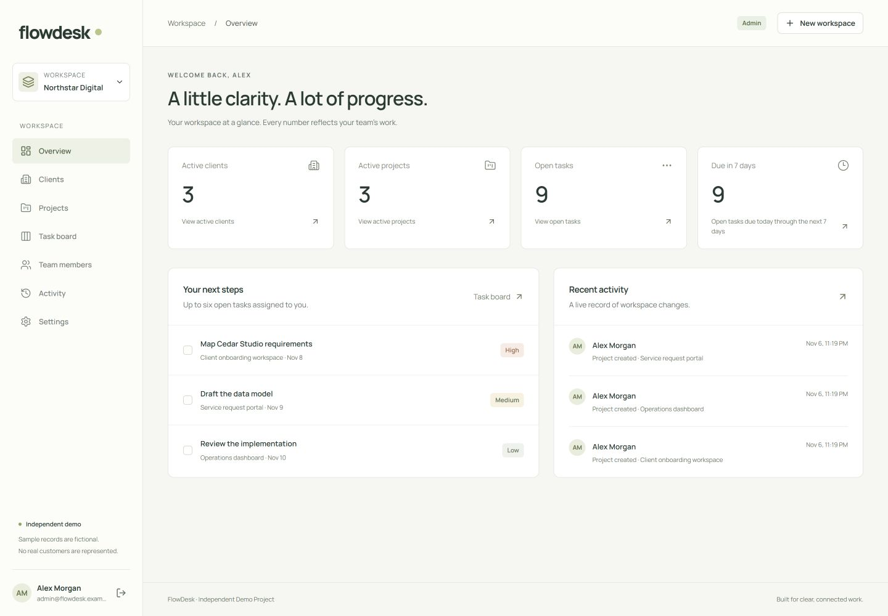

# FlowDesk — connected business operations

**Independent Demo Project. All organizations, people and records are fictional.**

Operational core completed and validated locally. Source publication has been approved; hosted deployment remains blocked. This is original portfolio software, not a commissioned client project or a claim of production adoption. [Arabic replacement copy](case-study.ar.md).

## Overview

FlowDesk connects organization memberships, clients, projects and tasks in one working application. The objective was a small, complete workflow with defensible data/access boundaries rather than a large feature list. The deliverable includes original code, a responsive interface, PostgreSQL migrations, tests and reviewable architecture decisions.

## Business problem

The design addresses a plausible small-team problem: client context in one place, project status elsewhere and unclear task ownership. This is a product hypothesis, not a report from customer interviews. The application keeps each task connected to its project, client and organization so progress has context.

## Target users and requirements

Small service teams are the intended audience. Admins configure the organization and membership; Managers coordinate business work; Members progress assigned tasks. Requirements were organization onboarding, role-aware operations, strong tenant separation, persistent related data, accessible status changes and traceable activity. Billing, integrations, AI and notifications were deliberately excluded.

## Solution and workflow

Register → create organization as Admin → add registered teammates → create client → connect project → create and assign task → progress To do / In progress / Review / Done → inspect activity. Dashboard totals query actual records. Project completion requires all tasks Done; archive preserves context. Referenced clients cannot be deleted; membership revocation preserves history and unassigns tasks.

## Architecture

Browser → Next.js App Router → same-origin API rewrite → NestJS → Prisma/PostgreSQL. The monorepo separates web, API, shared contracts/capabilities and database schema/migrations. No cache, broker or job system is required. Authentication is a request boundary; membership/capability/tenant checks run in the organization transaction; relational constraints provide another boundary below the API. Business mutation and audit insert commit together.

## Domain model

User joins Organization through Membership, where the role lives. Organization owns Client → Project → Task. Creator and assignee reference memberships in the same organization. RefreshSession represents revocable authentication; AuditEvent records actor/action/entity/time/safe metadata. AuthThrottle stores shared rate counters. Composite `(id, organizationId)` keys and foreign keys enforce same-tenant relationships.

## RBAC

Central capabilities define Admin, Manager and Member behavior. Admin manages workspace/membership; Manager manages clients/projects/tasks; Member reads workspace records and changes only assigned tasks. Last-active-Admin demotion/removal is blocked. Admin activity is organization-wide, Manager activity covers business entities, and Member activity is limited to their own actions. The implemented model does not restrict Members to assigned projects: active members can read the business workspace.

## Tenant isolation

An organization ID in a URL is context, not permission. The API authenticates, acquires the organization lock, reloads active membership, evaluates capabilities and scopes queries. Foreign resource IDs return not found. Strict inputs reject spoofed organization fields; foreign client/project/assignee relationships fail validation and composite database constraints. UI visibility never grants authority.

## Authentication

Argon2id hashes passwords. Access JWTs last ten minutes and require an active backing session. Refresh secrets are random, hashed in storage, rotated transactionally and subject to replay-family revocation. Absolute session expiry is seven days. Logout revokes current family; logout-all revokes all sessions. Cookies are HttpOnly/SameSite with production Secure prefixes; tokens are absent from JSON and web storage.

## Security decisions

Exact trusted Origin plus custom header protects browser mutations; CORS is narrow. Strict Zod input, payload limits, shared auth throttling and safe request-ID errors reduce accidental exposure. Canonical-origin validation and explicit private-service binding prepare hosting configuration. These controls are implemented, but public-demo restrictions, hard quotas, retention and deployed HTTPS validation remain launch work. No certification or broad security guarantee is claimed.

## Database integrity

Two SQL migrations create typed states, unique keys, indexes, composite relations and check constraints for task versions, project dates and throttle counts. Membership history remains referenced after revocation. Client deletion fails when projects reference it. Completed/archived projects are read only until reopened. Migrations apply to both local development and isolated test databases without drift.

## Concurrency decisions

Task edits/status/deletion carry the last-read version; stale writes return conflict. Organization locks serialize business and membership writes, preventing a role/revocation race from being accepted under stale membership. Refresh operations serialize per user with advisory transaction locks. This favors understandable correctness for small teams; it is not a throughput or scale claim.

## UX decisions

Calm workspace navigation separates clients, projects, tasks, people and activity. Details maintain the client/project relationship. Native forms/dialogs support validation, confirmation and focus behavior; explicit status selectors work with a keyboard and avoid drag-only interaction. Desktop board columns collapse for smaller widths. Loading, empty, error, conflict and read-only states are part of the workflow. Page-level board counts are labeled honestly.

## Testing strategy and validation

**Implemented and validated locally:** 37 tests — 34 real Nest/PostgreSQL integration scenarios and three environment-configuration tests. They cover cross-organization lists/records/writes, foreign references, database constraints, role denials, last Admin, session expiry/replay/revocation, optimistic conflicts, lifecycle rules and safe errors. Formatting, lint, typecheck, production builds, Prisma validation, migration status/diff, dependency audit and publication scan are part of the local quality gate.

The real browser completed registration through organization/client/project/task assignment/status/activity, checked all three roles and keyboard completion, and verified persistence on reload. Current screenshots come from the running built application using the fictional Northstar seed. This is observed local evidence, not automated cross-browser or live uptime evidence.

## Challenges

- Authorization races required shared transaction boundaries, not just controller checks.
- Composite foreign keys had to match service validation so data could not cross organizations below the API.
- Refresh replay revocation had to commit before returning an error, rather than rolling back its security effect.
- Compiled startup smoke caught a missing direct Express dependency despite source tests/builds passing; it is now declared directly.
- Screenshot review found a desktop project heading that clipped its actions; a small flex-layout correction resolved it without adding features.

## Lessons

Negative scenarios are central product evidence. A permission matrix written before screens makes role behavior clearer. Task versions and transactional audit make concurrency and accountability explicit. Build success is not the same as compiled-process startup. Public exposure changes the threat model: a functional local workflow still needs demo abuse controls, bounded data and operational recovery.

## Known limitations

Workspace-wide read access, 40-task paginated board, all-reference selectors for a small team, strict cross-tab refresh replay behavior, no password recovery/email verification/MFA/invitations. No load-test metrics, real-user research, customer usage, security certification or production reliability claim. Public-demo quotas, reset/provisioning, readiness, retention, backups and monitoring are future work; see [demo strategy](demo-strategy.md).

## Technology stack

Next.js 16.4.5; React 19.3.1; TypeScript 5.9.3; Tailwind 4.3.4; NestJS 12.4.0; Express 5.3.0; PostgreSQL 18.6 at validation; Prisma 7.10.1; Zod 4.6.7; Argon2id; pnpm workspaces; Docker Compose. No Redis/BullMQ, AI, analytics expansion or real-time system is implemented.

## Screenshots and evidence

[All nine screenshots](screenshots/README.md) · [Permission matrix](permissions.md) · [Tenant isolation](tenant-isolation.md) · [REST API](api.md).

## GitHub and live demo

**GitHub:** [akramaldwikat/flowDesk](https://github.com/akramaldwikat/flowDesk), the approved source repository. **Live demo:** not deployed; no public URL or public credentials. Add a live-demo destination only after deployment is separately approved and verified. After publication, the portfolio status may become **Completed Independent Demo Project**, while hosting limitations remain explicit.

## Implemented / validated / future

| State               | Scope                                                                                                   |
| ------------------- | ------------------------------------------------------------------------------------------------------- |
| Implemented         | Operational core, original UI/API, sessions, capabilities, tenant constraints, audit, local seed        |
| Validated locally   | 37 tests, browser workflow/roles/responsive evidence, builds/migrations/audits                          |
| Prepared            | Public README/screenshots, source review, case study, production configuration and launch runbook       |
| Future, not claimed | Hosting, safe demo-mode policies, reset tooling, operational recovery/monitoring, portfolio publication |
