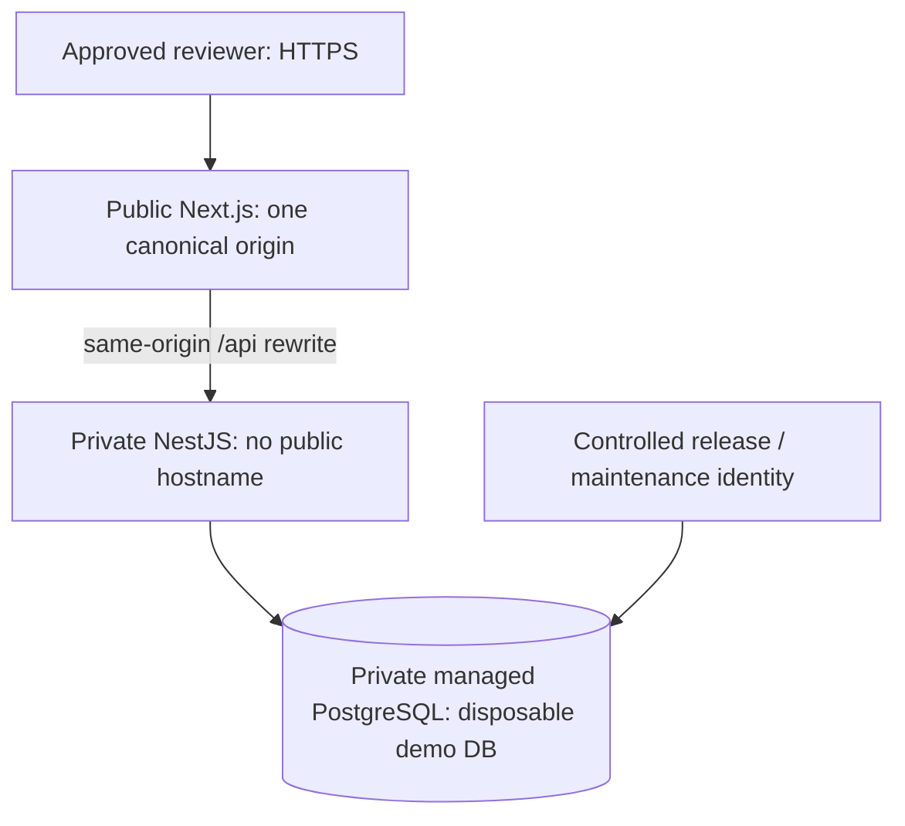

# Deployment preparation — not executed

**Recommend one Render region/workspace: paid Next.js web service + private NestJS service + paid managed PostgreSQL.** No resources, domains, accounts or credentials have been created. Resolve the [demo launch gaps](demo-strategy.md) and obtain Akram's cost/domain/access approval before deployment.

## Architecture comparison

| Choice                                | Cost / maintenance                                                                         | Reliability / complexity                                                              | Decision                                                                |
| ------------------------------------- | ------------------------------------------------------------------------------------------ | ------------------------------------------------------------------------------------- | ----------------------------------------------------------------------- |
| Render web + private API + managed DB | Three paid resources plus storage/traffic/workspace charges; managed TLS and DB operations | One provider, private same-region connections, conventional persistent Node processes | **Recommend.** Avoids a second public API origin and OS administration. |
| Vercel + Node host + managed DB       | Multiple vendor plans, bills and network boundaries                                        | Good frontend hosting; extra cross-provider setup and professional-use plan review    | Viable, unnecessary here.                                               |
| Single VPS + proxy + PostgreSQL       | Potentially lower cash cost; owner patches OS, proxy, backups and restore                  | Small diagram but one failure domain and substantial operational responsibility       | More maintenance for this portfolio.                                    |

Checked 7 November 2026: [private services](https://render.com/docs/private-services) have no public subdomain; [web services](https://render.com/docs/web-services) require a `0.0.0.0` bind; [private networking](https://render.com/docs/private-network) offers internal service/DB URLs; [managed TLS](https://render.com/docs/tls) covers platform/custom hostnames. [Paid PostgreSQL](https://render.com/docs/postgresql-creating-connecting) offers recovery/export features. Prefer paid always-on instances over [free-plan limitations](https://render.com/docs/free). These are provider capabilities, not evidence of a deployed FlowDesk system.

Cost: obtain a live dashboard quotation for two Node services, PostgreSQL compute/storage, traffic/build usage, taxes and any workspace charge. The [compute table](https://render.com/docs/compute-plans) starts Node instances at 512 MB, but that is not validated capacity for concurrent Argon2 requests. The retrieved dynamic [pricing page](https://render.com/pricing) did not reliably expose a complete quote, so no fixed monthly total is asserted. Approve a spending limit and alerts before creation. [Vercel pricing](https://vercel.com/pricing) identifies Hobby as personal/non-commercial; do not assume freelance portfolio use automatically qualifies.



All paths, including `/api`, custom/platform hostnames and maintenance routes, must follow the approved access policy. A secret URL is not access control. Backend membership/capability/tenant checks remain mandatory even on private networking.

## Configuration reference

Use `.env.production.example` as a reference for provider settings, not as a file to upload. Never reuse development secrets, TEST_DATABASE_URL or the local DEMO_PASSWORD.

| Process     | Required setting                                                                                                                                      |
| ----------- | ----------------------------------------------------------------------------------------------------------------------------------------------------- |
| Both        | `NODE_ENV=production`; locked Node/pnpm versions                                                                                                      |
| API         | `WEB_ORIGIN=https://<approved-host>` — canonical origin with no path, slash, credentials, query or fragment                                           |
| API         | New independent `JWT_SECRET` from at least 48 random bytes; internal managed `DATABASE_URL`                                                           |
| API         | `API_BIND_HOST=0.0.0.0`, `API_PORT=10000`; local defaults stay loopback/4100                                                                          |
| API         | `TRUST_PROXY=false` until verified. Current true trusts one hop, not an arbitrary Render topology.                                                    |
| Web         | `API_INTERNAL_URL=http://<actual-private-api-host>:10000`, supplied before build and at runtime; rewrite destinations are compiled into the web build |
| Maintenance | Separate demo-only migration/reset identities; never browser-visible                                                                                  |

The API now rejects noncanonical origins, requires HTTPS, rejects known JWT secret placeholders in production and supports an explicit private-service bind. Next rejects invalid internal origins. Production access cookies use `__Host-fd_access` on `/`; refresh uses `__Secure-fd_refresh` on `/api/auth`. Both are HttpOnly, Secure, SameSite=Lax. Preserve original Origin and `X-FlowDesk-Request` through Next. CORS allows only WEB_ORIGIN.

Next may aggregate apparent client IPs at the API. Verify the entire provider → Next → API chain and sanitize forwarding at the boundary before changing proxy trust. Conservative shared throttling is safer than spoofable forwarded-IP trust; add account/global budgets before launch.

## Proposed release commands

These are future host commands, not a deployment performed here:

```sh
pnpm install --frozen-lockfile
pnpm db:generate
pnpm build
```

Web start on a POSIX host: `pnpm --filter @flowdesk/web exec next start --hostname 0.0.0.0 --port "$PORT"`. Its local start script intentionally binds to loopback/3100. Private API start: `pnpm --filter @flowdesk/api start`, using its explicit bind/port settings. Build environments must install required dev tooling even when NODE_ENV is production.

Run `pnpm db:migrate` once as a controlled release step before API traffic. Do not seed or schema-push on startup. Validate committed migrations/drift in disposable staging first. Use backups and compatible app rollback/restore for later destructive migrations; do not silently rewrite schema history.

`/api/health` is process liveness, not ongoing DB readiness. Add/test DB-backed readiness and provider failure behavior before launch. Operational smoke must traverse HTTPS → Next rewrite → API → database. Redact cookies, passwords and connection strings from logs/alerts.

## Acceptance order after approval

1. Implement/test the selected access restrictions, quotas, session/audit retention, provisioning/reset command and DB readiness.
2. Approve actual provider quotation, domain, secret handling and private credential distribution.
3. Configure canonical origin/private host before building; apply migrations with release identity.
4. Provision fictional fixtures through a separate approved command. Existing local seed must continue to refuse production.
5. Test HTTPS cookie flags, hostile/missing Origin, registration denial, quotas, session expiry, default-host access, private API and cross-tenant denials.
6. Rehearse reset/restore and restart persistence; validate storage/cost/failure alerts.
7. Record verified URLs, then separately approve portfolio updates.

No blueprint that could accidentally create billable resources is added. This is configuration/runbook preparation; the current app must not be exposed unchanged.
